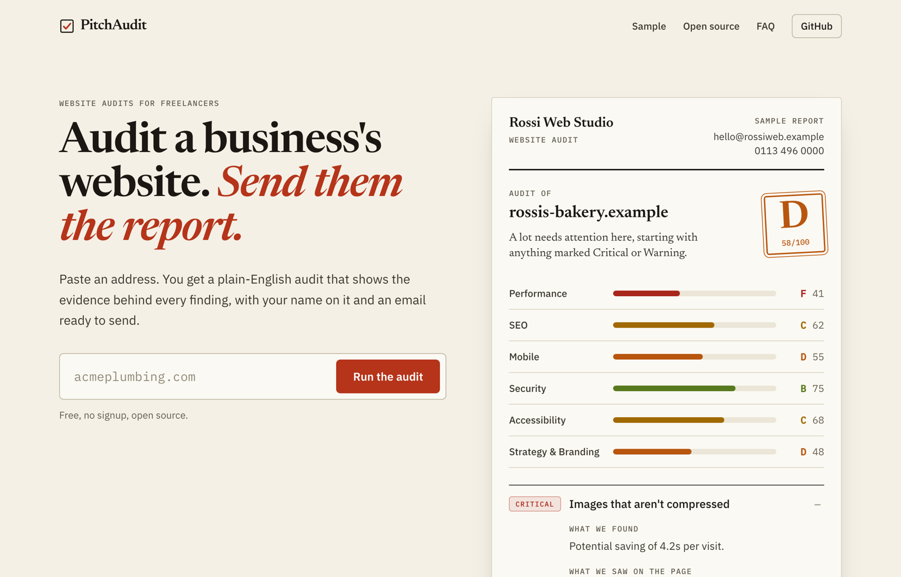

# PitchAudit

**Audit a business's website. Send them the report.**

PitchAudit is a free, open-source website audit tool for freelancers and small
agencies. Paste an address and you get a plain-English report that shows the
evidence behind every finding, with your name on it and a short email ready to
send.



## What it does

- **Audits a public page** with Google Lighthouse (speed and accessibility) and
  30+ checks of its own: search visibility, mobile, conversion basics,
  accessibility and security basics.
- **Shows its evidence.** Every finding says what it saw on the page: the actual
  `<title>` tag, the missing header, the image files with no alt text. You can
  check a claim in seconds before your name goes on it.
- **Explains each finding** in plain English: why it matters, how much, and how
  to fix it. Small things are called small.
- **Writes the email.** Short drafts that quote only what the audit found. No
  promised results.
- **Puts your name on it.** Your name, logo, colour and contact line on every
  report, then print to PDF.
- **Bulk audits** up to 25 sites, ranked weakest first, with CSV export.
- **Compares** a site with a competitor, category by category.

No account. Your branding and recent audits stay in your browser.

## What it doesn't do

- No backlink, keyword-ranking or traffic data. That needs a paid SEO database.
- It reads the public page only. Anything behind a login, or added only after
  the page loads, is invisible to it.
- Some sites turn automated visitors away. You get a clear message rather than
  a wrong report.
- If Lighthouse doesn't run, speed and accessibility show as **not measured**
  and the grade is marked **provisional** instead of being guessed.

## How accurate is it?

Before release, 24 of the checks were run on 33 real small-business sites and
every result was compared with an independent script. The handful of
disagreements turned out to be bugs, and they're fixed and covered by tests
([tests/false-positives.test.ts](tests/false-positives.test.ts)). Automated
audits still get things wrong, which is why every finding shows its evidence.
If you find a wrong finding, please
[open an issue](../../issues/new?template=wrong-finding.md).

## Run it yourself

You need Node.js 22 or newer.

```bash
git clone https://github.com/YenFus/pitchaudit
cd pitchaudit
npm install
cp .env.example .env.local   # then add your PSI_API_KEY
npm run dev                  # http://localhost:3000
```

### Configuration

| Variable | |
|---|---|
| `PSI_API_KEY` | Strongly recommended. A [free PageSpeed Insights key](https://developers.google.com/speed/docs/insights/v5/get-started) (25,000 audits a day, no billing). Without it Google rate-limits you almost at once and grades are provisional. |
| `UPSTASH_REDIS_REST_URL`, `UPSTASH_REDIS_REST_TOKEN` | Optional. Shares rate limits and the one-hour audit cache across serverless instances. Without them both live in memory. |
| `NEXT_PUBLIC_SITE_URL`, `NEXT_PUBLIC_DOMAIN` | Optional. Your public address, used in links, the sitemap and social cards. |
| `NEXT_PUBLIC_REPO_URL` | Optional. Where the "GitHub" links point, if you fork it. |
| `TRUST_PROXY_HEADERS` | Self-hosting only. Set to `true` if your own reverse proxy sets `X-Forwarded-For`. Not needed on Vercel. See [SECURITY.md](SECURITY.md). |

Limits (rate limit, bulk size) and the product name live in
[lib/config.ts](lib/config.ts).

### Deploying

It's a standard Next.js app and runs on Vercel or any Node host. Note that
Vercel's free Hobby plan is for non-commercial use.

## How it works

| Piece | Where |
|---|---|
| Direct checks: HTML, headers, robots.txt, sitemap, favicon, http→https | [lib/audit/checks.ts](lib/audit/checks.ts) |
| Google PageSpeed Insights (mobile and desktop) | [lib/audit/psi.ts](lib/audit/psi.ts) |
| Scoring, and leaving out what couldn't be measured | [lib/audit/score.ts](lib/audit/score.ts) |
| Plain-English copy and the one-line email sentence for each finding | [lib/audit/impact-copy.ts](lib/audit/impact-copy.ts) |
| Email drafts | [lib/email-snippets.ts](lib/email-snippets.ts) |
| Fetching sites safely: blocks private addresses at connect time (DNS rebinding), caps pages at 6 MB | [lib/audit/transport.ts](lib/audit/transport.ts), [lib/audit/ssrf.ts](lib/audit/ssrf.ts) |

### Adding a check

1. Detect it in `runHtmlAndHeaderChecks` (or `runChecks` for network probes)
   in [lib/audit/checks.ts](lib/audit/checks.ts), and push an issue with an
   `id`, a `severity`, a `finding` and `evidence` lines saying what you saw.
2. Add its title, impact and fix to
   [lib/audit/impact-copy.ts](lib/audit/impact-copy.ts). Add a `pitch` sentence
   only if it's worth leading an email with.
3. Add tests, including at least one page where it must **not** fire.

## Development

```bash
npm test            # offline test suite
npm run test:live   # also audits a few real websites (needs a network)
npm run lint
npm run build
```

`?print=1` on any report shows the print/PDF layout.

## Security

See [SECURITY.md](SECURITY.md) for how the app guards against being used to
reach private networks, and how to report a vulnerability privately.

## Contributing

Issues and pull requests are welcome; see [CONTRIBUTING.md](CONTRIBUTING.md).
The most useful contribution is a report of a finding that's wrong on a real
site.

## License

[MIT](LICENSE)
